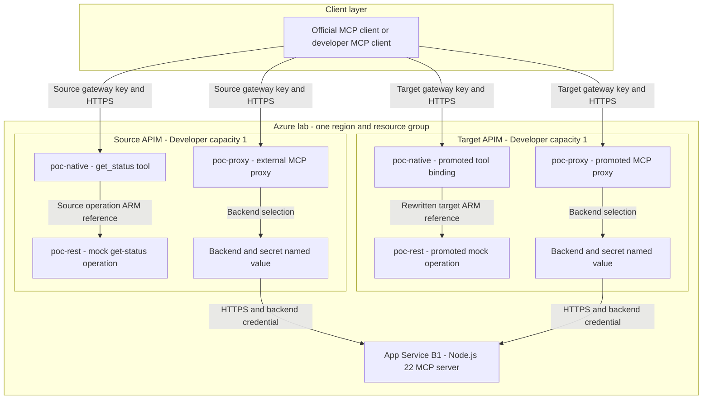
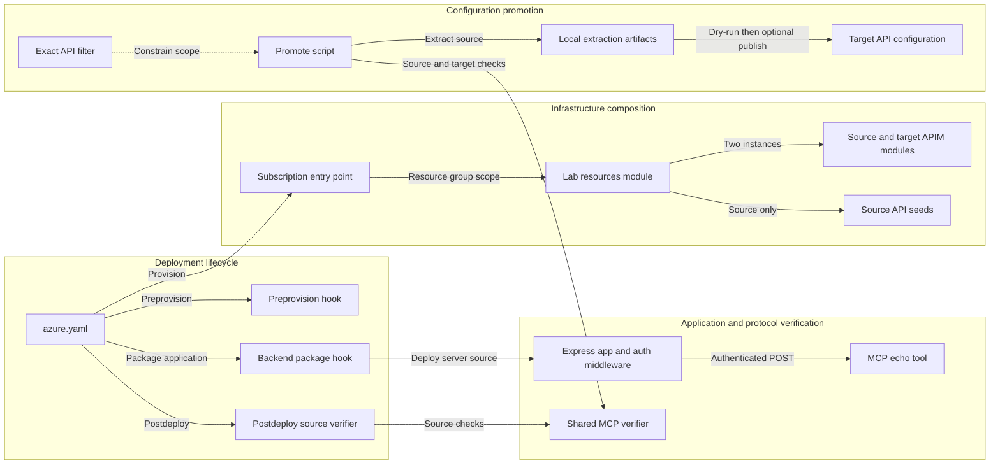

# Architecture Diagram

This lab separates infrastructure/application deployment with azd from APIM API
configuration promotion with APIops. Two Developer-tier APIM instances exercise
native REST-to-MCP and external MCP proxy behavior.

[Project overview](../../../../../README.md) | [Operations](../../../../../docs/operations.md) | [Testing and security](../../../../../docs/testing-and-security.md)

## Application Architecture

<!-- mermaid-checked: quoted labels, explicit subgraph IDs, closed subgraphs, unique node IDs. -->

### Technology Stack Summary

| Layer | Technology | Version or SKU | Purpose |
| --- | --- | --- | --- |
| Provisioning | Azure Developer CLI and Bicep | Local azd packaging verified with 1.35.1 | Create the lab, package and deploy backend code, invoke hooks. |
| Gateway | Azure API Management | Developer, capacity 1 in each instance | Host native MCP tools and govern a proxy to the external server. |
| API configuration | Azure APIops CLI | 1.0.5, development dependency | Extract API artifacts and publish them to the target APIM. |
| ARM MCP configuration | APIM APIs management surface | 2025-09-01-preview | Include MCP API types and bindings during extraction/publication. |
| Application hosting | Linux Azure App Service | Basic B1 plan | Host one shared backend, Node 22 LTS, Always On and health check. |
| Application runtime | Node.js | 22 or later locally; 22 LTS in Azure | Run ESM server and test scripts. |
| HTTP server | Express | 5.3.0 | Health, authentication, JSON parsing and MCP routes. |
| MCP server/client | Model Context Protocol SDK | 1.32.1 | Stateless Streamable HTTP tools and automated protocol checks. |
| Input validation | Zod | 4.6.7 | Validate the `echo` message, 1 to 200 characters. |
| Operations | PowerShell on Windows; Bash on Linux/macOS | PowerShell 7.2 or later; Bash | Equivalent hooks, CLI exit handling, promotion checks and mocked regression tests. |

### Data Storage & External Services

There is no database, cache, queue, model endpoint or user-data persistence in the
application. The backend returns deterministic tool responses. Azure retains
infrastructure/application configuration; APIM and App Service each store their
configured credential values. Local azd state and APIops extraction artifacts are
operator-side files, not application data stores.

The only external application backend is the project's own App Service. Both APIM
instances have separate backend and subscription resources but deliberately share
that application and its credential.

### Key Architectural Decisions

1. **Two gateways, same API contract.** Keep names and paths unchanged while testing
   cross-instance ARM operation-reference rewriting. The source REST mock and target
   REST mock are distinct APIM resources; a target MCP tool must point at the latter.
2. **Explicit ownership.** Bicep owns infrastructure, dependencies and source seeds.
   APIops owns target PoC APIs. This makes successful promotion observable rather
   than silently recreating target APIs through infrastructure templates.
3. **Small, deterministic lab.** A mock REST operation and an authenticated echo
   backend avoid LLM cost and nondeterminism. The trade-off is shared backend scope,
   simple shared-secret authentication and no production network isolation.

### Request paths and trust boundaries

| Path | Flow | Authentication | Result |
| --- | --- | --- | --- |
| Native MCP | Client -> APIM MCP API -> instance-local mock REST operation | APIM subscription key | `get_status` text contains `apiops-rest-ok`. |
| External MCP | Client -> APIM proxy -> configured backend -> App Service `/mcp` | APIM subscription key, then injected backend key | `echo` text JSON includes supplied message and `source: external-mcp`. |
| Backend health | Operator/App Service probe -> `/health` | Anonymous | `{"status":"ok"}`; does not prove APIM/MCP functionality. |
| Promotion | Operator -> ARM APIs | Azure identity management permissions | API configuration changes only; no application deployment. |

The backend's configured `protocol: http` is an APIM backend protocol category;
the actual backend URL is **HTTPS**, and certificate-chain/name validation is enabled.
The backend is stateless: POST is supported on `/mcp`; authenticated GET/DELETE
requests receive 405. No long-lived session store is provisioned.

## Component Relationships

Solid arrows show execution or data flow; dotted arrows show configuration dependencies.
APIops artifacts remain local and are not deployed with the backend package.

<!-- mermaid-checked: quoted labels, explicit subgraph IDs, closed subgraphs, unique node IDs. -->

### Component Inventory

Paths below are relative to the repository root.

| Component | Layer | Type | Responsibility |
| --- | --- | --- | --- |
| `azure.yaml` | Lifecycle | azd manifest | Select Bicep and App Service; connect hooks to deployment lifecycle. |
| `infra/main.bicep` | Infrastructure | Subscription template | Create lab resource group, pass secure credential, expose non-secret azd outputs. |
| `infra/resources.bicep` | Infrastructure | Resource group template | Compose hosting, two APIM instances and source-only API seeds. |
| `infra/apim-instance.bicep` | Infrastructure | Reusable module | Create Developer APIM, backend, secret named value and broad lab test subscription. |
| `infra/source-apis.bicep` | Gateway configuration | Seed module | Create REST mock, native tool binding and proxy API in source. |
| `scripts/ps1/Preprovision.ps1`, `scripts/bash/preprovision.sh` | Lifecycle | Hook | Check azd subscription and fail provisioning if local tests fail. |
| `scripts/ps1/Package-Backend.ps1`, `scripts/bash/package-backend.sh` | Lifecycle | Hook | Copy only manifests/source into a clean backend staging directory. |
| `scripts/ps1/Verify-Source.ps1`, `scripts/bash/verify-source.sh` | Verification | Hook | Verify health and source MCP endpoints after application deployment. |
| `scripts/ps1/Common.ps1`, `scripts/bash/common.sh` | Operations | Shared helpers | Enforce CLI subscription, check exit codes, load test keys without printing them. |
| `scripts/ps1/Promote.ps1`, `scripts/bash/promote.sh` | Promotion | Orchestrator | Extract exact APIs, inspect metadata, preview/apply, validate target reference and source preservation. |
| `config/source-filter.yaml` | Promotion | Scope definition | Select exactly the three source API names. |
| `scripts/test-mcp.mjs` | Verification | CLI client | Test both MCP scenarios for the chosen gateway. Source/target labels do not rewrite paths. |
| `scripts/mcp-client.mjs` | Verification | Protocol helper | Initialize, list tools, invoke the expected tool, assert text, close client. |
| `src/server.mjs` | Runtime | Express and MCP server | Check backend key, validate JSON/tool input, create per-request transport and return deterministic response. |

## Deployment and promotion boundaries

1. `azd up` creates/updates the resource group, both APIM instances, their dependencies,
   source API seeds, and the App Service deployment.
2. The postdeploy verifier checks **source only**. A successful azd run does not
   mean the three target APIs have been promoted.
3. `Promote.ps1` reads source/target management resources, tests source, extracts
   exactly three APIs and runs publisher dry-run.
4. With `-Apply`, it publishes to target, checks the native tool's **full target
   operation ARM ID**, verifies canonical paths and source snapshot, then tests both gateways.
5. A failed apply is not transactional; target changes can remain. There is no
   automated rollback or full backup/restore implementation.

The architecture is intentionally single-region and uses public endpoints.
It demonstrates gateway/configuration separation, not complete environment
isolation, cross-subscription promotion or disaster recovery.
