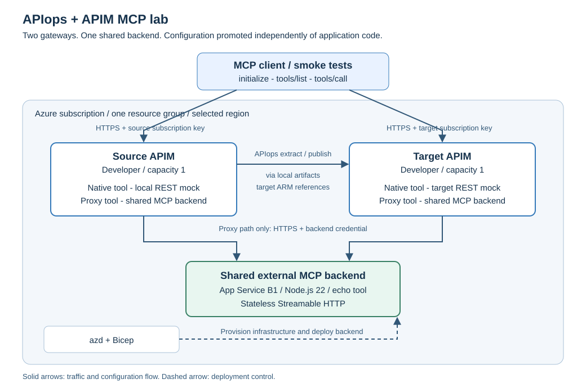

# Azure APIops MCP Lab

[](https://github.com/seilorjunior/azure-apiops-mcp-lab/actions/workflows/ci.yml)
[](LICENSE)

**Independent community example.** This is not an official Microsoft product,
supported reference architecture or production-ready deployment. The upstream
[Azure APIops CLI](https://github.com/Azure/apiops-cli) is a separate project.

**A reproducible proof of concept for promoting MCP configuration between two
Developer-tier Azure API Management instances with the Azure APIops CLI.**

This project tests two questions:

1. Can a REST API exposed as MCP tools be extracted and published to another APIM?
2. Can an APIM proxy for an existing MCP server be promoted the same way?

Azure Developer CLI (`azd`) provisions the lab and deploys the MCP application.
APIops extracts and publishes the APIM APIs. The acceptance test is a real MCP
initialization, tool discovery and tool call against **both** gateways, not merely
a successful deployment command.

> **Before use:** this lab creates **two billed Developer APIM instances** and a
> billed App Service plan. There are [known dependency advisories](docs/dependency-risks.md).
> Azure promotion is **disabled by default** and requires explicit opt-in and
> protected environments. Review [validation scope](docs/validation.md); successful
> sample runs do not certify another subscription or production deployment.

Dependency risks are tracked by a separate weekly/manual
[audit workflow](.github/workflows/dependency-audit.yml). It fails on unaccepted
high/critical advisories, expired exceptions or audit errors. Run
`npm run audit:dependencies` locally after `npm ci`; normal PR CI stays offline.
See the [audit policy and exception process](docs/dependency-risks.md#automated-tracking).

## Documentation

| Read this | To understand |
| --- | --- |
| [Architecture and component diagrams](.github/modernize/assessment/engines/facts/architecture-diagram.md) | Azure topology, MCP request flows, module relationships and design decisions. |
| [Deployment and operations](docs/operations.md) | Prerequisites, azd setup, credentials, deployment, APIops promotion, configuration and cleanup. |
| [GitHub Actions promotion](docs/github-actions.md) | Manual dry-run/apply workflow, Azure OIDC, environment approvals and configuration variables. |
| [Git-versioned API snapshots](docs/api-snapshots.md) | Hash-only configuration snapshots and explicit API-subset publication from local PowerShell or Bash. |
| [Testing and security](docs/testing-and-security.md) | What each test proves, live acceptance checklist, trust boundaries and production gaps. |
| [Troubleshooting](docs/troubleshooting.md) | Parameter/hook failures, authentication errors, tool binding failures and partial deployments. |
| [Validation scope](docs/validation.md) | What offline and live checks prove, and remaining gates. |
| [Dependency risk register](docs/dependency-risks.md) | Known advisories, upstream blockers and opt-in policy. |
| [Contributing](CONTRIBUTING.md) / [Security policy](SECURITY.md) | Local CI, contribution review and private vulnerability reporting. |

## Architecture at a glance



The overview uses SVG so it displays without a Mermaid preview extension.
The [detailed architecture](.github/modernize/assessment/engines/facts/architecture-diagram.md)
includes editable Mermaid diagrams.

<details>
<summary>Overview diagram source (Mermaid)</summary>

```text
flowchart TD
    OverviewClient["MCP client or smoke test"]
    subgraph OverviewAzure["Azure subscription - one lab resource group"]
        OverviewSource["Source APIM - Developer"]
        OverviewTarget["Target APIM - Developer"]
        OverviewBackend["Shared MCP backend - App Service B1"]
    end
    OverviewArtifacts["Local API artifacts"]
    OverviewAzd["azd and Bicep"]
    OverviewClient -->|"HTTPS and source subscription key"| OverviewSource
    OverviewClient -->|"HTTPS and target subscription key"| OverviewTarget
    OverviewSource -->|"Proxy MCP with backend credential"| OverviewBackend
    OverviewTarget -->|"Proxy MCP with backend credential"| OverviewBackend
    OverviewSource -->|"APIops extract"| OverviewArtifacts
    OverviewArtifacts -->|"APIops publish"| OverviewTarget
    OverviewAzd -.->|"Provision and deploy"| OverviewAzure
```

</details>

The native `get_status` MCP tool uses an APIM mock REST operation and does **not**
call App Service. The `echo` MCP tool uses the shared external backend. See the
[detailed architecture](.github/modernize/assessment/engines/facts/architecture-diagram.md)
for both paths.

## What is deployed

| Component | Quantity | Purpose |
| --- | --- | --- |
| APIM Developer, capacity 1 | 2 | Dedicated source and target API configuration. |
| Linux App Service Basic B1 plan | 1 | Hosts the shared external MCP server. |
| Node.js App Service application | 1 | Stateless Streamable HTTP MCP `echo` tool and health endpoint. |
| APIM backend, secret named value and test subscription | One set per APIM | Pre-provisioned dependencies for API-only promotion. |
| Source API seed definitions | 3 APIs | `poc-rest`, `poc-native`, `poc-proxy`; target APIs are created only by APIops. |

No LLM, Azure OpenAI deployment, database, container registry or AI subscription
is needed to run the automated MCP checks. An MCP client can call the tools directly.
Developer-tier APIM has no production SLA. Both APIM instances and the App Service
plan incur charges while provisioned, even when there is no test traffic.

## Start here

Use PowerShell 7.2 or later on Windows, or Bash on Linux/macOS. Install Node.js 22
or later, npm, Azure CLI with Bicep, and Azure Developer CLI. Bash source verification
also requires `curl`; JSON processing uses Node, so `jq` is not required.

From the repository root:

```powershell
npm ci
npm test
az bicep build --file .\infra\main.bicep --stdout
```

These tests do not deploy resources. Script tests mock Azure and APIops.
`npm test` selects the PowerShell regression suites on Windows and the Bash suite
on Linux/macOS. azd also selects platform-specific hooks automatically.

### Reuse this example

1. Fork this repository or create a copy under your account. The Azure-connected
   workflow does not receive the original repository's identity, secrets or
   variables. Repository rulesets, branch protections and environment approval
   settings are not supplied by the copied files. Complete the
   [repository setup checklist](docs/github-actions.md#repository-setup-checklist)
   in your own repository.
2. Run `npm ci` and `npm test`; no Azure credentials are needed for offline tests.
3. Follow the [azd quickstart](docs/operations.md#deploy-with-azd-only-after-explicit-approval):
   choose your subscription and region, provide `APIM_PUBLISHER_EMAIL`, review
   infrastructure preview, then explicitly deploy.
4. Verify source MCP endpoints and preview promotion. Apply only after reviewing
   the target and publisher output.
5. For GitHub execution, configure your own OIDC identity, private identifier secrets, resource variables,
   required reviewers and branch restrictions using the [workflow guide](docs/github-actions.md).
   Configure your numeric GitHub user ID in `APIM_PROMOTION_ALLOWED_ACTOR_ID`.
   Set `ENABLE_AZURE_PROMOTION=true` only after reviewing dependency risks.
6. When finished, inspect the dedicated resource group and follow
   [cleanup instructions](docs/operations.md#cleanup-and-cost-control). Billing
   continues until the Azure resources are removed.

### Pull request reviews

The upstream repository automatically requests Copilot reviews for new pull
requests targeting any branch, including drafts. New pushes do not automatically
request another review. For PRs into `main`, the
[CODEOWNERS file](.github/CODEOWNERS) assigns every file to `@seilorjunior`.
A separate review ruleset requires a code-owner approval, with a PR-only owner
bypass for solo-maintainer merges. This bypass also applies to other authors' PRs;
it is not an author-based exemption. The owner reviews and merges PRs manually.
Copilot feedback does not count as approval or replace required CI.

Fork maintainers must replace the CODEOWNERS login and configure their own review
and Copilot rulesets; copying repository files does not install these settings. See
[review setup](docs/github-actions.md#configure-pull-request-protection-and-copilot)
and the [contribution guide](CONTRIBUTING.md#changes-and-review).

| Operation | Windows PowerShell | Linux/macOS Bash |
| --- | --- | --- |
| Shared helpers | [Common.ps1](scripts/ps1/Common.ps1) | [common.sh](scripts/bash/common.sh) |
| Preprovision | [Preprovision.ps1](scripts/ps1/Preprovision.ps1) | [preprovision.sh](scripts/bash/preprovision.sh) |
| Package backend | [Package-Backend.ps1](scripts/ps1/Package-Backend.ps1) | [package-backend.sh](scripts/bash/package-backend.sh) |
| Verify source | [Verify-Source.ps1](scripts/ps1/Verify-Source.ps1) | [verify-source.sh](scripts/bash/verify-source.sh) |
| APIops promotion | [Promote.ps1](scripts/ps1/Promote.ps1) | [promote.sh](scripts/bash/promote.sh) |

Execute `.sh` scripts with `bash`; do not source entry-point scripts into your
interactive shell. Shared JavaScript MCP clients remain directly under `scripts`.

Promotion and postdeploy verification first run a read-only
[preflight](scripts/preflight.mjs): supported hosting tier, Always On, backend
health, both APIM dependencies and private credential consistency. They fail on
drift rather than changing the hosting tier or permissions automatically.
MCP failures identify the protocol phase and elapsed time. GitHub runs produce a
sanitized summary on success or failure; raw exports are never uploaded.

**First deployment:** follow [the azd runbook](docs/operations.md#deploy-with-azd-only-after-explicit-approval)
to configure authentication, the repository's subscription guard and an environment,
then review `azd provision --preview` before `azd up`.

**Already have an environment:** use
[the existing-environment procedure](docs/operations.md#continuing-an-existing-environment).
Do not create another environment just because a hook failed. East US 2 is an
example region; your selected `AZURE_LOCATION` determines deployment location.

**After deployment:** follow
[the promotion procedure](docs/operations.md#extract-preview-publish-verify).
The default is a dry-run. Add `-Apply` only after reviewing the target and changes.

## MCP endpoint contract

Both instances retain identical API names and paths. The gateway hostname and
subscription key distinguish source from target.

| Scenario | API name | Gateway path | Tool | Expected result |
| --- | --- | --- | --- | --- |
| Native REST-to-MCP | `poc-native` | `/poc-native/mcp` | `get_status` | Text contains `apiops-rest-ok`. |
| External MCP proxy | `poc-proxy` | `/poc-proxy/mcp` | `echo` | Text contains the submitted `apiops-proxy-ok` message. |
| Underlying mock REST operation | `poc-rest` | `/poc-rest/status` | Not an MCP endpoint | JSON status `apiops-rest-ok`. |

APIM requests require `Ocp-Apim-Subscription-Key`. The external server independently
requires `x-poc-backend-key`, injected by the APIM backend configuration.
These are **different credentials**. Never commit them or paste local environment
contents into documentation, logs, screenshots or support requests.

## Repository map

| Location | Responsibility |
| --- | --- |
| [azure.yaml](azure.yaml) | azd service, infrastructure provider and lifecycle hooks. |
| [.github/workflows/promote.yml](.github/workflows/promote.yml) | Manual API promotion with OIDC, default dry-run and separate apply environment. |
| [infra/main.bicep](infra/main.bicep) | Subscription-scope resource group and azd outputs. |
| [infra/resources.bicep](infra/resources.bicep) | App Service and source/target APIM module composition. |
| [infra/apim-instance.bicep](infra/apim-instance.bicep) | Reusable Developer APIM with backend, secret named value and test subscription. |
| [infra/source-apis.bicep](infra/source-apis.bicep) | REST mock and two MCP APIs, seeded only in source. |
| [infra/main.parameters.json](infra/main.parameters.json) | azd parameter substitutions. |
| [src/server.mjs](src/server.mjs) | Authenticated stateless MCP backend. |
| [scripts/ps1/](scripts/ps1/), [scripts/bash/](scripts/bash/) | Equivalent platform-specific deployment hooks and APIops promotion. |
| [scripts/](scripts/) | Shared JavaScript MCP verification clients. |
| [config/source-filter.yaml](config/source-filter.yaml) | Exact API extraction/publication scope. |
| [test/](test/) | Backend tests and mocked PowerShell/Bash regression suites. |
| [package.json](package.json), [package-lock.json](package-lock.json) | Pinned dependency graph and npm commands. |
| [docs/](docs/) | Operator documentation. |

Local `.azure/<environment>` state, `.local/backend` staging and `artifacts/run-*`
are generated and excluded from Git. No documentation relies on the contents
of a local `.env`.

## Deliberate boundaries

- This is a lab, not a production landing zone or complete disaster recovery test.
- Source and target share a subscription, resource group, region, application and
  backend credential; separate gateways do not provide full environment isolation.
- Bicep seeds source APIs and dependencies. APIops promotes only APIs and children,
  without transitive dependency export or unmatched-resource deletion.
- APIops 1.0.5 and ARM `2025-09-01-preview` are the tested configuration assumptions.
  MCP APIs are not exported as OpenAPI specifications.
- GitHub Actions automates manual API promotion only; it does not provision the lab.
- No automated rollback, MCP client OAuth, private networking, Key Vault
  integration, multi-region failover or observability deployment is included.
- Dependency advisories remain a deployment-review item; local tests do not clear them.

## References

- [Azure APIops CLI](https://github.com/Azure/apiops-cli/tree/v1.0.5)
- [Expose REST APIs as MCP](https://learn.microsoft.com/azure/api-management/export-rest-mcp-server)
- [Expose an existing MCP server](https://learn.microsoft.com/azure/api-management/expose-existing-mcp-server)
- [Azure Developer CLI overview](https://learn.microsoft.com/azure/developer/azure-developer-cli/overview)
- [MCP TypeScript SDK](https://github.com/modelcontextprotocol/typescript-sdk)
